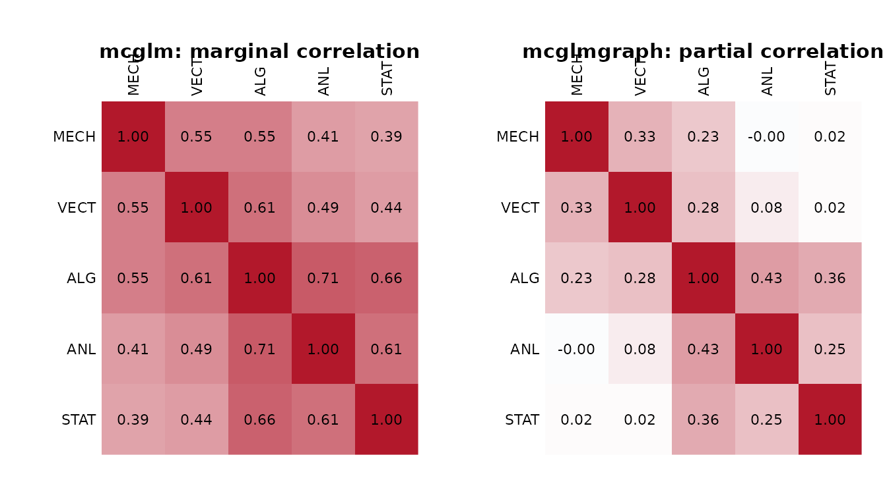
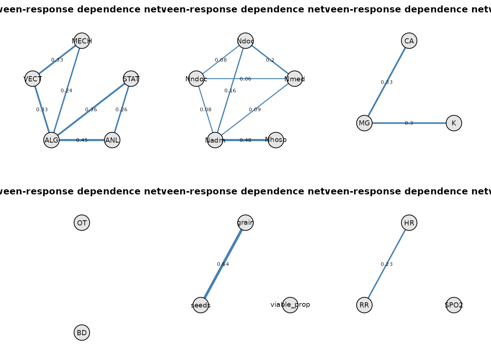

# mcglm and mcglmgraph Side by Side

## What is being compared, and what is not

This vignette runs the standard MCGLM engine and the graph-structured
engine on the same six datasets and puts the two outputs next to each
other. Before any number appears, it is worth being explicit about what
such a comparison can and cannot show, because the two fits are not
rivals estimating the same thing.

[`mcglm_graph()`](https://evandeilton.github.io/mcglmgraph/reference/mcglm_graph.md)
**contains** [`mcglm()`](https://rdrr.io/pkg/mcglm/man/mcglm.html). It
fits the marginal mean and dispersion blocks by calling
[`mcglm()`](https://rdrr.io/pkg/mcglm/man/mcglm.html), extracts the
standardized Pearson residuals, forms their between-response sample
covariance, and fits the graph layer to that second-order object. The
graph layer is a *second stage* on residuals; it never revisits the mean
structure.

Three consequences follow, and the tables below confirm all three
empirically:

1.  **The regression coefficients are identical, not merely similar.**
    Not “close to”, not “within tolerance”: bit-for-bit the same
    numbers, because they come from the same call. Any table comparing
    them is a check that the two-stage contract holds, not a horse race.
2.  **The comparison is entirely about the between-response object.**
    Standard MCGLM summarizes it as `R(R-1)/2` unstructured correlations
    `rho`. `mcglmgraph` parametrizes it as a precision matrix and reads
    *conditional* association off it.
3.  **The extra cost is the second stage only.** Everything the marginal
    fit costs is paid by both.

So the honest question is not “which fits better”. It is: *given that
you have already paid for an MCGLM fit, what does the graph layer let
you say that the correlation vector does not?*

``` r

library(mcglmgraph)
library(mcglm)
```

## The comparison harness

Two small readers, then the fitting wrapper. `beta_of()` deliberately
calls [`coef()`](https://rdrr.io/r/stats/coef.html) with no `type`, so
the `mcglm_graph` method falls through to the inherited one and both
objects are read the same way.

``` r

beta_of <- function(f) { cf <- coef(f); cf$Estimates[cf$Type == "beta"] }

## mcglm reports the between-response correlations as a vector in the order of
## utils::combn(R, 2); rebuild the matrix so it can sit beside mc_partial_cor().
rho_matrix <- function(rho, nm) {
  R <- length(nm); idx <- t(utils::combn(R, 2L))
  M <- diag(R); dimnames(M) <- list(nm, nm)
  M[idx] <- rho; M[idx[, 2:1]] <- rho
  M
}

## mcglm() takes the Tweedie/Poisson-Tweedie power through control_initial.
init_power <- function(lp, data, link, variance, power, Z,
                       Ntrial = NULL, covariance = NULL, offset = NULL) {
  R <- length(lp); n <- nrow(data)
  if (is.null(Ntrial))     Ntrial     <- rep(list(rep(1, n)), R)
  if (is.null(covariance)) covariance <- rep("identity", R)
  if (is.null(offset))     offset     <- rep(list(NULL), R)
  ini <- suppressMessages(mc_initial_values(
    linear_pred = lp, matrix_pred = Z, link = as.list(link),
    variance = as.list(variance), covariance = as.list(covariance),
    offset = offset, Ntrial = Ntrial, data = data))
  ini$power <- lapply(power, as.numeric)
  ini
}

## Fit the same specification with both engines and time each one.
fit_pair <- function(spec) {
  args <- c(list(linear_pred = spec$lp, matrix_pred = spec$Z,
                 data = spec$data), spec$args)
  t_m <- system.time(m <- suppressWarnings(suppressMessages(
    do.call(mcglm::mcglm, args))))[["elapsed"]]
  t_g <- system.time(g <- suppressWarnings(suppressMessages(do.call(
    mcglm_graph, c(list(between_graph = mc_between_graph("ggm")), args)
  ))))[["elapsed"]]
  list(name = spec$name, m = m, g = g, t_m = t_m, t_g = t_g)
}
```

The pair-level reader is where the two engines actually meet. From the
standard fit it takes the marginal correlation and its standard error;
from the graph fit it takes the partial correlation and its delta-method
standard error. Same pairs, same rows, two readings.

``` r

pair_table <- function(p) {
  g <- p$g$graph; nm <- g$response_names
  idx <- t(utils::combn(g$R, 2L))
  smry <- summary(p$m)$Correlation
  del  <- mc_partial_cor_delta(p$g)
  rho    <- as.numeric(smry[, "Estimates"])
  rho_se <- as.numeric(smry[, "Std.error"])
  data.frame(
    pair    = paste(nm[idx[, 1]], nm[idx[, 2]], sep = "-"),
    rho     = rho,
    rho_p   = 2 * stats::pnorm(-abs(rho / rho_se)),
    pcor    = del$pcor,
    pcor_se = del$se,
    pcor_p  = del$p_value,
    ## how much of the marginal association survives conditioning
    shrink  = 1 - abs(del$pcor) / pmax(abs(rho), 1e-8),
    row.names = NULL, stringsAsFactors = FALSE)
}
```

Finally, a matrix display, base graphics only, so the two covariance
readings can be shown as panels next to each other.

``` r

show_matrix <- function(M, main, digits = 2) {
  R <- nrow(M); lab <- rownames(M)
  lim <- max(abs(M))
  pal <- grDevices::colorRampPalette(c("#2166AC", "white", "#B2182B"))(64)
  graphics::image(seq_len(R), seq_len(R), t(M[R:1, , drop = FALSE]),
                  col = pal, zlim = c(-lim, lim), axes = FALSE,
                  xlab = "", ylab = "", main = main, cex.main = .95)
  graphics::axis(3, at = seq_len(R), labels = lab, tick = FALSE, las = 2,
                 cex.axis = .7, line = -.8)
  graphics::axis(2, at = seq_len(R), labels = rev(lab), tick = FALSE, las = 2,
                 cex.axis = .7, line = -.8)
  for (i in seq_len(R)) for (j in seq_len(R))
    graphics::text(j, R - i + 1,
                   formatC(M[i, j], format = "f", digits = digits), cex = .7)
  invisible(NULL)
}
```

## Six specifications

The six datasets span the response types MCGLM was built for:
continuous, counts with and without an offset, a binomial proportion,
and a bounded physiological signal. The model specifications are the
published ones, so the numbers here are comparable to the analyses these
datasets are known for.

``` r

specs <- list()
```

**`marks` (88 x 5, continuous).** Exam scores in five mathematics
subjects, the canonical dataset of the graphical-models literature. No
covariates: the mean is an intercept per response, so the whole model
*is* the dependence structure. This is the cleanest possible test of
what the two readings say.

``` r

data(marks, package = "bnlearn"); marks <- as.data.frame(marks)
specs$marks <- list(
  name = "marks", data = marks,
  lp = lapply(names(marks), function(v) stats::reformulate("1", response = v)),
  Z  = rep(list(mc_id(marks)), 5),
  args = list(link = rep("identity", 5), variance = rep("constant", 5),
              control_algorithm = list(max_iter = 100L, tol = 1e-5,
                                       verbose = FALSE)))
```

**`ahs` (5190 x 5, counts).** Australian Health Survey; five
health-service counts under Poisson-Tweedie with the power estimated.

``` r

data(ahs, package = "mcglm"); ahs <- as.data.frame(ahs)
ahs_lp <- lapply(c("Ndoc", "Nndoc", "Nadm", "Nhosp", "Nmed"), function(v)
  stats::reformulate(c("sex", "age", "income"), response = v))
ahs_Z <- rep(list(mc_id(ahs)), 5)
specs$ahs <- list(
  name = "ahs", data = ahs, lp = ahs_lp, Z = ahs_Z,
  args = list(link = rep("log", 5), variance = rep("poisson_tweedie", 5),
              power_fixed = rep(FALSE, 5),
              control_initial = init_power(ahs_lp, ahs, rep("log", 5),
                rep("poisson_tweedie", 5), rep(1, 5), ahs_Z),
              control_algorithm = list(max_iter = 100L, tol = 1e-5,
                                       verbose = FALSE)))
```

**`soil` (250 x 3, positive continuous).** Soil chemistry with a spatial
trend surface in the mean and an inverse covariance link.

``` r

data(soil, package = "mcglm"); soil <- as.data.frame(soil)
soil_lp <- lapply(c("CA", "MG", "K"), function(v) stats::reformulate(
  c("COORD.X * COORD.Y", "SAND", "SILT", "CLAY", "PHWATER"), response = v))
soil_Z <- rep(list(mc_id(soil)), 3)
specs$soil <- list(
  name = "soil", data = soil, lp = soil_lp, Z = soil_Z,
  args = list(link = rep("log", 3), variance = rep("tweedie", 3),
              power_fixed = rep(TRUE, 3), covariance = rep("inverse", 3),
              control_initial = init_power(soil_lp, soil, rep("log", 3),
                rep("tweedie", 3), rep(1.5, 3), soil_Z,
                covariance = rep("inverse", 3)),
              control_algorithm = list(max_iter = 1000L, tuning = 0.1,
                                       verbose = FALSE, tol = 1e-3)))
```

**`Hunting` (1216 x 2, counts with offset).** Two prey types, hunting
effort as an offset, and a hunter-month random effect in the
within-response block. With `R = 2` there is exactly one candidate edge,
which makes it the boundary case.

``` r

data(Hunting, package = "mcglm"); Hunting <- as.data.frame(Hunting)
Hunting <- Hunting[order(Hunting$HUNTER, Hunting$MONTH), , drop = FALSE]
Hunting$HUNTER.MONTH <- factor(Hunting$HUNTER.MONTH)
hunt_Z <- rep(list(c(mc_id(Hunting),
                     mc_mixed(~ 0 + HUNTER.MONTH, data = Hunting))), 2)
hf <- OT ~ METHOD * ALT + SEX + ALT * poly(MONTH, 4)
hunt_lp <- list(hf, stats::update(hf, BD ~ .))
hunt_off <- rep(list(log(Hunting$OFFSET)), 2)
specs$Hunting <- list(
  name = "Hunting", data = Hunting, lp = hunt_lp, Z = hunt_Z,
  args = list(link = rep("log", 2), variance = rep("poisson_tweedie", 2),
              power_fixed = rep(FALSE, 2), offset = hunt_off,
              control_initial = init_power(hunt_lp, Hunting, rep("log", 2),
                rep("poisson_tweedie", 2), rep(1, 2), hunt_Z,
                offset = hunt_off),
              control_algorithm = list(max_iter = 100L, tol = 1e-5,
                                       verbose = FALSE)))
```

**`soya` (75 x 3, mixed types).** A continuous yield, a count, and a
binomial proportion in the same model, each with its own link and
variance function.

``` r

data(soya, package = "mcglm"); soya <- as.data.frame(soya)
soya$viable_prop <- with(soya, viablepeas / totalpeas)
soya_lp <- list(grain ~ block + factor(water) * factor(pot),
                seeds ~ block + factor(water) * factor(pot),
                viable_prop ~ block + factor(water) * factor(pot))
soya_Z <- rep(list(mc_id(soya)), 3)
soya_Nt <- list(NULL, NULL, soya$totalpeas)
specs$soya <- list(
  name = "soya", data = soya, lp = soya_lp, Z = soya_Z,
  args = list(link = c("identity", "log", "logit"),
              variance = c("constant", "tweedie", "binomialP"),
              power_fixed = rep(TRUE, 3), Ntrial = soya_Nt,
              control_initial = init_power(soya_lp, soya,
                c("identity", "log", "logit"),
                c("constant", "tweedie", "binomialP"), c(0, 1, 1),
                soya_Z, Ntrial = soya_Nt),
              control_algorithm = list(max_iter = 100L, tol = 1e-5,
                                       verbose = FALSE)))
```

**`NewBorn` (270 x 3, physiological).** Heart rate, respiratory rate and
oxygen saturation on premature newborns.

``` r

data(NewBorn, package = "mcglm"); NewBorn <- as.data.frame(NewBorn)
specs$NewBorn <- list(
  name = "NewBorn", data = NewBorn,
  lp = list(HR ~ Sex + GA, RR ~ Sex + GA, SPO2 ~ Sex + GA),
  Z = rep(list(mc_id(NewBorn)), 3),
  args = list(link = c("log", "log", "identity"),
              variance = c("tweedie", "tweedie", "constant"),
              power_fixed = rep(TRUE, 3),
              control_algorithm = list(max_iter = 100L, tol = 1e-5,
                                       verbose = FALSE)))
```

## Running both engines

``` r

fits <- lapply(specs, fit_pair)
sels <- lapply(fits, function(p) suppressWarnings(suppressMessages(
  mc_graph_stepwise(p$g, criterion = "gbic", trace = FALSE))))
pts  <- lapply(fits, pair_table)
#> Call: MECH ~ 1
#> <environment: 0x570975ea4480>
#> 
#> Link function: identity 
#> Variance function: constant 
#> Covariance function: identity 
#> 
#> Regression:
#>             Estimates Std.error  Z value     Pr(>|z|)
#> (Intercept)  38.95455  1.864038 20.89794 5.590799e-97
#> 
#> Dispersion:
#>   Estimates Std.error  Z value     Pr(>|z|)
#> 1   305.768  83.70606 3.652878 0.0002593172
#> 
#> Call: VECT ~ 1
#> <environment: 0x570975eb0e90>
#> 
#> Link function: identity 
#> Variance function: constant 
#> Covariance function: identity 
#> 
#> Regression:
#>             Estimates Std.error  Z value      Pr(>|z|)
#> (Intercept)  50.59091  1.401469 36.09848 2.396089e-285
#> 
#> Dispersion:
#>   Estimates Std.error  Z value    Pr(>|z|)
#> 1  172.8422  60.17941 2.872116 0.004077339
#> 
#> Call: ALG ~ 1
#> <environment: 0x5709762a20d8>
#> 
#> Link function: identity 
#> Variance function: constant 
#> Covariance function: identity 
#> 
#> Regression:
#>             Estimates Std.error  Z value Pr(>|z|)
#> (Intercept)  50.60227  1.132605 44.67776        0
#> 
#> Dispersion:
#>   Estimates Std.error  Z value   Pr(>|z|)
#> 1   112.886   60.3568 1.870311 0.06144066
#> 
#> Call: ANL ~ 1
#> <environment: 0x5709762a5310>
#> 
#> Link function: identity 
#> Variance function: constant 
#> Covariance function: identity 
#> 
#> Regression:
#>             Estimates Std.error  Z value      Pr(>|z|)
#> (Intercept)  46.68182  1.582505 29.49869 2.992937e-191
#> 
#> Dispersion:
#>   Estimates Std.error  Z value    Pr(>|z|)
#> 1  220.3804  77.67579 2.837182 0.004551365
#> 
#> Call: STAT ~ 1
#> <environment: 0x5709762aa4d8>
#> 
#> Link function: identity 
#> Variance function: constant 
#> Covariance function: identity 
#> 
#> Regression:
#>             Estimates Std.error  Z value      Pr(>|z|)
#> (Intercept)  42.30682  1.839452 22.99969 4.695108e-117
#> 
#> Dispersion:
#>   Estimates Std.error  Z value    Pr(>|z|)
#> 1  297.7554    98.736 3.015672 0.002564108
#> 
#> Correlation:
#>    Parameters Estimates Std.error  Z value     Pr(>|z|)
#> 1       rho12 0.5534052 0.1697977 3.259202 1.117260e-03
#> 2       rho13 0.5467511 0.2205704 2.478806 1.318231e-02
#> 3       rho14 0.4093920 0.2596890 1.576470 1.149175e-01
#> 4       rho15 0.3890993 0.2563953 1.517576 1.291214e-01
#> 5       rho23 0.6096447 0.2057834 2.962555 3.050969e-03
#> 6       rho24 0.4850813 0.2419941 2.004517 4.501468e-02
#> 7       rho25 0.4364487 0.2529081 1.725721 8.439767e-02
#> 8       rho34 0.7108058 0.1579082 4.501387 6.751151e-06
#> 9       rho35 0.6647357 0.1753142 3.791682 1.496307e-04
#> 10      rho45 0.6071743 0.1736072 3.497403 4.698113e-04
#> 
#> Algorithm: chaser 
#> Correction: TRUE 
#> Number iterations: 5 
#> Call: Ndoc ~ sex + age + income
#> <environment: 0x570976878328>
#> 
#> Link function: log 
#> Variance function: poisson_tweedie 
#> Covariance function: identity 
#> 
#> Regression:
#>             Estimates  Std.error    Z value     Pr(>|z|)
#> (Intercept) -1.728187 0.12843369 -13.455868 2.843807e-41
#> sexfemale    0.227515 0.07959147   2.858535 4.256015e-03
#> age          1.235649 0.18611692   6.639100 3.156041e-11
#> income      -0.262696 0.11215642  -2.342229 1.916896e-02
#> 
#> Power:
#>   Estimates Std.error   Z value Pr(>|z|)
#> 1  1.351322  2.237591 0.6039183 0.545898
#> 
#> Dispersion:
#>   Estimates Std.error   Z value  Pr(>|z|)
#> 1   1.58598  4.509265 0.3517158 0.7250514
#> 
#> Call: Nndoc ~ sex + age + income
#> <environment: 0x570976892690>
#> 
#> Link function: log 
#> Variance function: poisson_tweedie 
#> Covariance function: identity 
#> 
#> Regression:
#>              Estimates Std.error    Z value     Pr(>|z|)
#> (Intercept) -2.5400132 0.2339598 -10.856622 1.854834e-27
#> sexfemale    0.4025182 0.1396155   2.883048 3.938468e-03
#> age          2.0110689 0.3227766   6.230529 4.648619e-10
#> income      -0.3191037 0.1992248  -1.601727 1.092160e-01
#> 
#> Power:
#>   Estimates Std.error   Z value  Pr(>|z|)
#> 1  1.192523  1.253787 0.9511369 0.3415349
#> 
#> Dispersion:
#>   Estimates Std.error   Z value  Pr(>|z|)
#> 1  4.201141  9.222331 0.4555401 0.6487207
#> 
#> Call: Nadm ~ sex + age + income
#> <environment: 0x570970846bb8>
#> 
#> Link function: log 
#> Variance function: poisson_tweedie 
#> Covariance function: identity 
#> 
#> Regression:
#>               Estimates  Std.error     Z value     Pr(>|z|)
#> (Intercept) -1.79315127 0.13549314 -13.2342584 5.564324e-40
#> sexfemale    0.03723894 0.08665208   0.4297525 6.673757e-01
#> age          0.68157230 0.20393941   3.3420333 8.316709e-04
#> income      -0.49548767 0.12547770  -3.9488105 7.854048e-05
#> 
#> Power:
#>   Estimates Std.error  Z value  Pr(>|z|)
#> 1  1.363322  9.211823 0.147997 0.8823451
#> 
#> Dispersion:
#>   Estimates Std.error    Z value  Pr(>|z|)
#> 1 0.8473357  13.81626 0.06132889 0.9510973
#> 
#> Call: Nhosp ~ sex + age + income
#> <environment: 0x57097083ff08>
#> 
#> Link function: log 
#> Variance function: poisson_tweedie 
#> Covariance function: identity 
#> 
#> Regression:
#>              Estimates Std.error    Z value     Pr(>|z|)
#> (Intercept) -0.0226000 0.2129316 -0.1061374 9.154734e-01
#> sexfemale   -0.2181634 0.1334946 -1.6342492 1.022065e-01
#> age          2.0292866 0.3157282  6.4273219 1.298716e-10
#> income      -0.9955249 0.1977963 -5.0330825 4.826552e-07
#> 
#> Power:
#>   Estimates Std.error  Z value     Pr(>|z|)
#> 1  1.469095 0.2897587 5.070062 3.976861e-07
#> 
#> Dispersion:
#>   Estimates Std.error  Z value     Pr(>|z|)
#> 1   21.3059  5.230797 4.073166 4.637836e-05
#> 
#> Call: Nmed ~ sex + age + income
#> <environment: 0x57097080a550>
#> 
#> Link function: log 
#> Variance function: poisson_tweedie 
#> Covariance function: identity 
#> 
#> Regression:
#>               Estimates  Std.error     Z value      Pr(>|z|)
#> (Intercept) -0.97634147 0.06171856 -15.8192522  2.291986e-56
#> sexfemale    0.49239766 0.03681850  13.3736465  8.620871e-41
#> age          1.94252474 0.08497610  22.8596604 1.171375e-115
#> income      -0.02133088 0.05028469  -0.4242023  6.714183e-01
#> 
#> Power:
#>   Estimates Std.error  Z value     Pr(>|z|)
#> 1  1.415695 0.1631497 8.677273 4.053705e-18
#> 
#> Dispersion:
#>   Estimates  Std.error  Z value     Pr(>|z|)
#> 1 0.5718239 0.06681894 8.557811 1.150302e-17
#> 
#> Correlation:
#>    Parameters  Estimates  Std.error  Z value     Pr(>|z|)
#> 1       rho12 0.12109899 0.02199767 5.505083 3.689952e-08
#> 2       rho13 0.21738835 0.03199788 6.793835 1.091909e-11
#> 3       rho14 0.10920138 0.03489712 3.129238 1.752604e-03
#> 4       rho15 0.23223263 0.02485263 9.344389 9.242184e-21
#> 5       rho23 0.12348484 0.02743873 4.500385 6.783058e-06
#> 6       rho24 0.10920310 0.03008999 3.629217 2.842827e-04
#> 7       rho25 0.10056362 0.01902881 5.284808 1.258367e-07
#> 8       rho34 0.48913360 0.09699213 5.043024 4.582323e-07
#> 9       rho35 0.15314542 0.02488881 6.153185 7.594214e-10
#> 10      rho45 0.09643055 0.02801156 3.442526 5.763080e-04
#> 
#> Algorithm: chaser 
#> Correction: TRUE 
#> Number iterations: 10 
#> Call: CA ~ COORD.X * COORD.Y + SAND + SILT + CLAY + PHWATER
#> <environment: 0x57096bbec1a8>
#> 
#> Link function: log 
#> Variance function: tweedie 
#> Covariance function: inverse 
#> 
#> Regression:
#>                     Estimates    Std.error   Z value     Pr(>|z|)
#> (Intercept)      4.720271e-02 0.4335139167  0.108884 9.132945e-01
#> COORD.X         -4.773947e-03 0.0007589175 -6.290468 3.165101e-10
#> COORD.Y         -7.691246e-04 0.0002428930 -3.166516 1.542767e-03
#> SAND            -1.758829e-02 0.0093633075 -1.878427 6.032284e-02
#> SILT            -7.922818e-03 0.0057826706 -1.370097 1.706567e-01
#> CLAY            -1.539145e-02 0.0044181290 -3.483703 4.945278e-04
#> PHWATER          3.897323e-01 0.0265205886 14.695464 6.892509e-49
#> COORD.X:COORD.Y  3.766334e-05 0.0000114596  3.286620 1.013976e-03
#> 
#> Dispersion:
#>   Estimates Std.error  Z value     Pr(>|z|)
#> 1  110.2486  9.799902 11.24997 2.316833e-29
#> 
#> Call: MG ~ COORD.X * COORD.Y + SAND + SILT + CLAY + PHWATER
#> <environment: 0x57096bbdff08>
#> 
#> Link function: log 
#> Variance function: tweedie 
#> Covariance function: inverse 
#> 
#> Regression:
#>                     Estimates    Std.error     Z value     Pr(>|z|)
#> (Intercept)     -1.515738e+00 0.4558538689 -3.32505175 8.840213e-04
#> COORD.X          3.288857e-04 0.0007963953  0.41296794 6.796301e-01
#> COORD.Y          1.177216e-03 0.0002548238  4.61972317 3.842524e-06
#> SAND            -2.477757e-04 0.0098454865 -0.02516643 9.799222e-01
#> SILT            -1.083557e-02 0.0060930154 -1.77835914 7.534489e-02
#> CLAY            -4.553889e-03 0.0046442415 -0.98054523 3.268171e-01
#> PHWATER          3.038208e-01 0.0278082220 10.92557363 8.698900e-28
#> COORD.X:COORD.Y -5.873893e-05 0.0000120631 -4.86930777 1.119899e-06
#> 
#> Dispersion:
#>   Estimates Std.error Z value     Pr(>|z|)
#> 1  203.0116  19.08757 10.6358 2.030805e-26
#> 
#> Call: K ~ COORD.X * COORD.Y + SAND + SILT + CLAY + PHWATER
#> <environment: 0x57096b966428>
#> 
#> Link function: log 
#> Variance function: tweedie 
#> Covariance function: inverse 
#> 
#> Regression:
#>                     Estimates    Std.error      Z value     Pr(>|z|)
#> (Intercept)     -3.354138e+00 1.092735e+00 -3.069489809 2.144247e-03
#> COORD.X         -4.118237e-03 1.931183e-03 -2.132493781 3.296628e-02
#> COORD.Y          1.520769e-04 6.142125e-04  0.247596544 8.044466e-01
#> SAND            -1.547689e-04 2.359798e-02 -0.006558567 9.947671e-01
#> SILT            -1.134093e-02 1.454011e-02 -0.779975766 4.354051e-01
#> CLAY            -3.057343e-02 1.110871e-02 -2.752204072 5.919562e-03
#> PHWATER          7.267730e-01 6.688395e-02 10.866178956 1.670514e-27
#> COORD.X:COORD.Y  5.983106e-05 2.873334e-05  2.082287274 3.731624e-02
#> 
#> Dispersion:
#>   Estimates Std.error  Z value     Pr(>|z|)
#> 1  45.69855  6.614154 6.909205 4.873789e-12
#> 
#> Correlation:
#>   Parameters Estimates  Std.error  Z value     Pr(>|z|)
#> 1      rho12 0.3422381 0.06521491 5.247851 1.538841e-07
#> 2      rho13 0.2129853 0.07513964 2.834527 4.589364e-03
#> 3      rho23 0.3178120 0.07439214 4.272119 1.936244e-05
#> 
#> Algorithm: chaser 
#> Correction: TRUE 
#> Number iterations: 92 
#> Call: OT ~ METHOD * ALT + SEX + ALT * poly(MONTH, 4)
#> 
#> Link function: log 
#> Variance function: poisson_tweedie 
#> Covariance function: identity 
#> 
#> Regression:
#>                        Estimates Std.error     Z value     Pr(>|z|)
#> (Intercept)            0.1114436 0.1393188   0.7999175 4.237586e-01
#> METHODTrampa           0.1975359 0.1911528   1.0333928 3.014201e-01
#> ALT2                  -1.1995320 0.2306749  -5.2000972 1.991843e-07
#> ALT3                  -2.2760649 0.2140205 -10.6348000 2.052686e-26
#> ALT4                  -1.8087428 0.2024542  -8.9340834 4.105675e-19
#> ALT5                  -0.7191452 0.2102224  -3.4208790 6.241910e-04
#> SEXMale               -0.6200356 0.0790683  -7.8417716 4.442337e-15
#> poly(MONTH, 4)1       -4.4349142 4.2214756  -1.0505602 2.934606e-01
#> poly(MONTH, 4)2        0.5630925 4.0683270   0.1384089 8.899173e-01
#> poly(MONTH, 4)3        3.8658870 3.8877322   0.9943810 3.200374e-01
#> poly(MONTH, 4)4       -7.0729203 3.8686411  -1.8282700 6.750905e-02
#> METHODTrampa:ALT2      0.4975777 0.2901590   1.7148448 8.637369e-02
#> METHODTrampa:ALT3      0.5108821 0.2846245   1.7949340 7.266421e-02
#> METHODTrampa:ALT4     -0.1060115 0.3165243  -0.3349237 7.376826e-01
#> METHODTrampa:ALT5     -0.8752377 0.2707771  -3.2323181 1.227903e-03
#> ALT2:poly(MONTH, 4)1  12.2169334 6.0832854   2.0082788 4.461367e-02
#> ALT3:poly(MONTH, 4)1  -5.8799733 6.6830203  -0.8798377 3.789472e-01
#> ALT4:poly(MONTH, 4)1  19.1652888 6.1981643   3.0920911 1.987518e-03
#> ALT5:poly(MONTH, 4)1   7.3909632 5.9790376   1.2361460 2.164043e-01
#> ALT2:poly(MONTH, 4)2 -21.7201062 5.8333020  -3.7234668 1.965057e-04
#> ALT3:poly(MONTH, 4)2   8.0169948 6.2182464   1.2892694 1.973044e-01
#> ALT4:poly(MONTH, 4)2  -3.4040820 6.1541247  -0.5531383 5.801687e-01
#> ALT5:poly(MONTH, 4)2 -10.0127661 5.8584478  -1.7091159 8.742949e-02
#> ALT2:poly(MONTH, 4)3 -10.4743849 5.8713403  -1.7839853 7.442605e-02
#> ALT3:poly(MONTH, 4)3  16.0567642 6.5090750   2.4668273 1.363161e-02
#> ALT4:poly(MONTH, 4)3  10.2031474 6.3110711   1.6167061 1.059417e-01
#> ALT5:poly(MONTH, 4)3 -15.1141039 5.7059550  -2.6488299 8.077098e-03
#> ALT2:poly(MONTH, 4)4   2.3525795 6.2172294   0.3783968 7.051359e-01
#> ALT3:poly(MONTH, 4)4   5.9821621 6.9202196   0.8644469 3.873425e-01
#> ALT4:poly(MONTH, 4)4   5.0487107 6.3236335   0.7983876 4.246456e-01
#> ALT5:poly(MONTH, 4)4  12.2379421 5.9089767   2.0710764 3.835166e-02
#> 
#> Power:
#>   Estimates Std.error  Z value     Pr(>|z|)
#> 1  1.710831 0.2223497 7.694323 1.422448e-14
#> 
#> Dispersion:
#>   Estimates Std.error  Z value     Pr(>|z|)
#> 1 0.3002199 0.1386053 2.166005 3.031079e-02
#> 2 0.6083746 0.1429471 4.255941 2.081712e-05
#> 
#> Call: BD ~ METHOD + ALT + SEX + poly(MONTH, 4) + METHOD:ALT + ALT:poly(MONTH, 
#>     4)
#> 
#> Link function: log 
#> Variance function: poisson_tweedie 
#> Covariance function: identity 
#> 
#> Regression:
#>                         Estimates  Std.error       Z value     Pr(>|z|)
#> (Intercept)            0.49233975 0.09944921   4.950665409 7.396017e-07
#> METHODTrampa          -0.27639074 0.13844200  -1.996437082 4.588637e-02
#> ALT2                  -0.13361273 0.13024764  -1.025836137 3.049688e-01
#> ALT3                   0.30603347 0.10395982   2.943766936 3.242441e-03
#> ALT4                   0.76437898 0.10585980   7.220673040 5.173090e-13
#> ALT5                   0.04460446 0.12947297   0.344507899 7.304644e-01
#> SEXMale               -0.59029072 0.02997222 -19.694593615 2.399144e-86
#> poly(MONTH, 4)1       -0.07342201 3.89199335  -0.018864887 9.849489e-01
#> poly(MONTH, 4)2      -12.46392246 3.78210387  -3.295499780 9.824678e-04
#> poly(MONTH, 4)3      -10.48003132 3.19286262  -3.282330799 1.029528e-03
#> poly(MONTH, 4)4        2.33329020 2.98802688   0.780879923 4.348731e-01
#> METHODTrampa:ALT2      0.45390375 0.17158579   2.645345786 8.160748e-03
#> METHODTrampa:ALT3      0.42104281 0.14948270   2.816665797 4.852499e-03
#> METHODTrampa:ALT4      0.51439225 0.15636797   3.289626682 1.003204e-03
#> METHODTrampa:ALT5      1.07686186 0.16104714   6.686625044 2.283760e-11
#> ALT2:poly(MONTH, 4)1 -17.50600580 4.59680599  -3.808297723 1.399267e-04
#> ALT3:poly(MONTH, 4)1   1.56463504 4.13236309   0.378629613 7.049629e-01
#> ALT4:poly(MONTH, 4)1  -5.96535193 4.05357858  -1.471626077 1.411219e-01
#> ALT5:poly(MONTH, 4)1  -3.83340749 4.23730096  -0.904681431 3.656342e-01
#> ALT2:poly(MONTH, 4)2   0.02323274 4.53184043   0.005126557 9.959096e-01
#> ALT3:poly(MONTH, 4)2   2.10837333 4.12657732   0.510925439 6.094033e-01
#> ALT4:poly(MONTH, 4)2   3.48612305 3.98824348   0.874099854 3.820639e-01
#> ALT5:poly(MONTH, 4)2   5.25501210 4.18271971   1.256362477 2.089846e-01
#> ALT2:poly(MONTH, 4)3   8.41209409 4.05557905   2.074202967 3.806046e-02
#> ALT3:poly(MONTH, 4)3  15.24512199 3.49109771   4.366856295 1.260476e-05
#> ALT4:poly(MONTH, 4)3  13.51309960 3.48896402   3.873098014 1.074606e-04
#> ALT5:poly(MONTH, 4)3  11.14550777 3.59945124   3.096446380 1.958553e-03
#> ALT2:poly(MONTH, 4)4  -4.22443659 3.88596219  -1.087101826 2.769918e-01
#> ALT3:poly(MONTH, 4)4  -9.13374367 3.38153616  -2.701063432 6.911815e-03
#> ALT4:poly(MONTH, 4)4  -3.97520738 3.35808349  -1.183772644 2.365031e-01
#> ALT5:poly(MONTH, 4)4  -3.78896098 3.52413738  -1.075145653 2.823095e-01
#> 
#> Power:
#>   Estimates Std.error  Z value     Pr(>|z|)
#> 1  1.473935 0.3389676 4.348307 1.371928e-05
#> 
#> Dispersion:
#>   Estimates Std.error  Z value   Pr(>|z|)
#> 1 0.1287377 0.1011289 1.273007 0.20301573
#> 2 0.4860474 0.2766760 1.756738 0.07896242
#> 
#> Correlation:
#>   Parameters   Estimates  Std.error   Z value   Pr(>|z|)
#> 1      rho12 -0.06703167 0.02951288 -2.271269 0.02313073
#> 
#> Algorithm: chaser 
#> Correction: TRUE 
#> Number iterations: 50 
#> Call: grain ~ block + factor(water) * factor(pot)
#> 
#> Link function: identity 
#> Variance function: constant 
#> Covariance function: identity 
#> 
#> Regression:
#>                                   Estimates Std.error     Z value     Pr(>|z|)
#> (Intercept)                      14.2454435  1.408468 10.11414185 4.781891e-24
#> blockII                           1.1323087  1.018419  1.11183025 2.662111e-01
#> blockIII                         -0.7794528  1.018455 -0.76532870 4.440758e-01
#> blockIV                          -1.5492854  1.018422 -1.52126135 1.281943e-01
#> blockV                           -2.3865079  1.018415 -2.34335602 1.911114e-02
#> factor(water)50                   2.1660181  1.770932  1.22309526 2.212937e-01
#> factor(water)62.5                 2.5404970  1.770931  1.43455467 1.514140e-01
#> factor(pot)30                     6.7893235  1.770921  3.83378064 1.261887e-04
#> factor(pot)60                    10.3980252  1.770910  5.87157254 4.316806e-09
#> factor(pot)120                   11.7895572  1.770917  6.65731673 2.788718e-11
#> factor(pot)180                   11.8634336  1.770898  6.69910699 2.096970e-11
#> factor(water)50:factor(pot)30     0.1068145  2.504471  0.04264951 9.659809e-01
#> factor(water)62.5:factor(pot)30  -1.8676731  2.504477 -0.74573381 4.558282e-01
#> factor(water)50:factor(pot)60     2.6031567  2.504466  1.03940606 2.986159e-01
#> factor(water)62.5:factor(pot)60   3.3581963  2.504464  1.34088404 1.799581e-01
#> factor(water)50:factor(pot)120    2.2543843  2.504473  0.90014313 3.680441e-01
#> factor(water)62.5:factor(pot)120  5.5830318  2.504449  2.22924559 2.579757e-02
#> factor(water)50:factor(pot)180    1.2095021  2.504459  0.48293952 6.291387e-01
#> factor(water)62.5:factor(pot)180  9.2387629  2.504456  3.68892931 2.251998e-04
#> 
#> Dispersion:
#>   Estimates Std.error  Z value     Pr(>|z|)
#> 1  7.844041  2.244658 3.494537 0.0004748847
#> 
#> Call: seeds ~ block + factor(water) * factor(pot)
#> 
#> Link function: log 
#> Variance function: tweedie 
#> Covariance function: identity 
#> 
#> Regression:
#>                                    Estimates  Std.error    Z value     Pr(>|z|)
#> (Intercept)                       4.80743939 0.07606991 63.1976457 0.0000000000
#> blockII                          -0.01824106 0.04499209 -0.4054282 0.6851628179
#> blockIII                         -0.03297048 0.04516283 -0.7300356 0.4653684018
#> blockIV                          -0.10656664 0.04602825 -2.3152444 0.0205995582
#> blockV                           -0.12613174 0.04626660 -2.7261940 0.0064069321
#> factor(water)50                   0.13216772 0.09679652  1.3654181 0.1721216725
#> factor(water)62.5                 0.18638702 0.09559607  1.9497351 0.0512076995
#> factor(pot)30                     0.29798297 0.09327816  3.1945631 0.0014004265
#> factor(pot)60                     0.34438029 0.09237216  3.7281828 0.0001928654
#> factor(pot)120                    0.36718061 0.09193978  3.9937079 0.0000650480
#> factor(pot)180                    0.29447224 0.09334644  3.1546168 0.0016070905
#> factor(water)50:factor(pot)30     0.04249536 0.12723806  0.3339831 0.7383923220
#> factor(water)62.5:factor(pot)30  -0.13723681 0.12796475 -1.0724580 0.2835143844
#> factor(water)50:factor(pot)60     0.11611009 0.12517712  0.9275664 0.3536325271
#> factor(water)62.5:factor(pot)60   0.09016163 0.12394104  0.7274558 0.4669467868
#> factor(water)50:factor(pot)120    0.11590026 0.12461128  0.9300944 0.3523221928
#> factor(water)62.5:factor(pot)120  0.06977368 0.12359191  0.5645489 0.5723806312
#> factor(water)50:factor(pot)180    0.29054249 0.12460741  2.3316630 0.0197184282
#> factor(water)62.5:factor(pot)180  0.21655814 0.12387371  1.7482170 0.0804264516
#> 
#> Dispersion:
#>   Estimates Std.error  Z value     Pr(>|z|)
#> 1   2.89296 0.4729358 6.117025 9.533855e-10
#> 
#> Call: viable_prop ~ block + factor(water) * factor(pot)
#> 
#> Link function: logit 
#> Variance function: binomialP 
#> Covariance function: identity 
#> 
#> Regression:
#>                                    Estimates Std.error     Z value     Pr(>|z|)
#> (Intercept)                      -0.83602281 0.2280847 -3.66540497 2.469475e-04
#> blockII                          -0.43826434 0.2177656 -2.01255074 4.416191e-02
#> blockIII                         -0.16706608 0.2116413 -0.78938329 4.298880e-01
#> blockIV                          -0.18748394 0.2123283 -0.88299076 3.772413e-01
#> blockV                           -0.29230868 0.2164919 -1.35020609 1.769499e-01
#> factor(water)50                   0.56750503 0.2522648  2.24963979 2.447182e-02
#> factor(water)62.5                 0.24140482 0.2535912  0.95194494 3.411249e-01
#> factor(pot)30                    -1.84551346 0.3813036 -4.84001032 1.298324e-06
#> factor(pot)60                    -3.15174290 0.6260658 -5.03420415 4.798381e-07
#> factor(pot)120                   -3.39156897 0.6907614 -4.90989950 9.112308e-07
#> factor(pot)180                   -3.63070048 0.7927407 -4.57993433 4.651219e-06
#> factor(water)50:factor(pot)30    -0.27721257 0.4914438 -0.56407781 5.727012e-01
#> factor(water)62.5:factor(pot)30   0.80455991 0.4624513  1.73977211 8.189904e-02
#> factor(water)50:factor(pot)60     0.45972536 0.7203740  0.63817594 5.233592e-01
#> factor(water)62.5:factor(pot)60   0.63107344 0.7290990  0.86555246 3.867356e-01
#> factor(water)50:factor(pot)120    0.68812770 0.7774631  0.88509368 3.761061e-01
#> factor(water)62.5:factor(pot)120 -0.83511935 1.0531045 -0.79300711 4.277737e-01
#> factor(water)50:factor(pot)180    1.27285290 0.8503248  1.49690203 1.344188e-01
#> factor(water)62.5:factor(pot)180  0.06806435 0.9739675  0.06988359 9.442863e-01
#> 
#> Dispersion:
#>   Estimates Std.error Z value     Pr(>|z|)
#> 1  1.736378 0.2068251 8.39539 4.643498e-17
#> 
#> Correlation:
#>   Parameters  Estimates Std.error   Z value     Pr(>|z|)
#> 1      rho12 0.63667673 0.1019482 6.2450987 4.235326e-10
#> 2      rho13 0.06831598 0.1766365 0.3867602 6.989337e-01
#> 3      rho23 0.08609107 0.1756610 0.4900977 6.240648e-01
#> 
#> Algorithm: chaser 
#> Correction: TRUE 
#> Number iterations: 11 
#> Call: HR ~ Sex + GA
#> 
#> Link function: log 
#> Variance function: tweedie 
#> Covariance function: identity 
#> 
#> Regression:
#>                Estimates   Std.error    Z value    Pr(>|z|)
#> (Intercept)  5.093978135 0.041233271 123.540482 0.000000000
#> SexMale      0.043000389 0.013210034   3.255131 0.001133402
#> GA          -0.003452972 0.001358903  -2.541000 0.011053577
#> 
#> Dispersion:
#>   Estimates Std.error Z value     Pr(>|z|)
#> 1  1.305439 0.1095497 11.9164 9.721476e-33
#> 
#> Call: RR ~ Sex + GA
#> 
#> Link function: log 
#> Variance function: tweedie 
#> Covariance function: identity 
#> 
#> Regression:
#>               Estimates   Std.error   Z value      Pr(>|z|)
#> (Intercept)  3.63741480 0.110363073 32.958622 3.183260e-238
#> SexMale     -0.11367073 0.034955315 -3.251887  1.146416e-03
#> GA           0.01125249 0.003624604  3.104475  1.906173e-03
#> 
#> Dispersion:
#>   Estimates Std.error  Z value     Pr(>|z|)
#> 1  3.102754 0.2500049 12.41078 2.284257e-35
#> 
#> Call: SPO2 ~ Sex + GA
#> 
#> Link function: identity 
#> Variance function: constant 
#> Covariance function: identity 
#> 
#> Regression:
#>                Estimates    Std.error    Z value  Pr(>|z|)
#> (Intercept) 0.9507037103 0.0113668312 83.6384118 0.0000000
#> SexMale     0.0055399751 0.0036291449  1.5265235 0.1268795
#> GA          0.0001545008 0.0003743587  0.4127078 0.6798207
#> 
#> Dispersion:
#>      Estimates    Std.error  Z value     Pr(>|z|)
#> 1 0.0006580396 4.934845e-05 13.33455 1.457231e-40
#> 
#> Correlation:
#>   Parameters   Estimates  Std.error   Z value     Pr(>|z|)
#> 1      rho12  0.22935574 0.05984309  3.832619 0.0001267864
#> 2      rho13 -0.04342121 0.06424710 -0.675847 0.4991377839
#> 3      rho23 -0.06575132 0.06400456 -1.027291 0.3042833560
#> 
#> Algorithm: chaser 
#> Correction: TRUE 
#> Number iterations: 5
```

## The master table

``` r

master <- do.call(rbind, Map(function(p, sel, pt) {
  R <- p$g$graph$R
  data.frame(
    dataset   = p$name,
    n         = p$g$graph$n,
    R         = R,
    beta_gap  = max(abs(beta_of(p$m) - beta_of(p$g))),
    rho_free  = choose(R, 2),
    edges     = sel$n_edges,
    dropped   = sprintf("%.0f%%", 100 * (1 - sel$n_edges / choose(R, 2))),
    flips     = sum(pt$rho_p < .05 & pt$pcor_p >= .05),
    wald_p    = unname(mc_test_independence(p$g, robust = TRUE)$p.value),
    sec_mcglm = round(p$t_m, 2),
    sec_graph = round(p$t_g, 2),
    row.names = NULL, stringsAsFactors = FALSE)
}, fits, sels, pts))
knitr::kable(master, digits = c(0, 0, 0, 10, 0, 0, 0, 0, 3, 2, 2))
```

|  | dataset | n | R | beta_gap | rho_free | edges | dropped | flips | wald_p | sec_mcglm | sec_graph |
|:---|:---|---:|---:|---:|---:|---:|:---|---:|---:|---:|---:|
| marks | marks | 88 | 5 | 0 | 10 | 6 | 40% | 1 | 0.000 | 0.36 | 0.29 |
| ahs | ahs | 5190 | 5 | 0 | 10 | 7 | 30% | 2 | 0.000 | 8.28 | 7.77 |
| soil | soil | 250 | 3 | 0 | 3 | 2 | 33% | 1 | 0.000 | 3.61 | 3.57 |
| Hunting | Hunting | 1216 | 2 | 0 | 1 | 0 | 100% | 1 | 0.079 | 5.28 | 5.38 |
| soya | soya | 75 | 3 | 0 | 3 | 1 | 67% | 0 | 0.004 | 0.42 | 0.43 |
| NewBorn | NewBorn | 270 | 3 | 0 | 3 | 1 | 67% | 0 | 0.001 | 0.17 | 0.17 |

Read the columns in three groups.

**`beta_gap` is exactly zero on every dataset.** This is the two-stage
contract, visible: the largest absolute discrepancy between the
regression coefficients of the two fits, across all six models and every
coefficient in them, is zero. The graph layer buys its structure without
touching a single mean parameter. If you were hoping the graph layer
would sharpen the regression estimates, this column is the answer: it
does not, and it is not meant to.

**`rho_free` versus `edges`.** The standard fit always carries
`R(R-1)/2` correlation parameters; it has no mechanism to decide that
one of them is unnecessary. The graph layer, selected by GBIC, keeps
between 0 and 7 of them. `Hunting` is the extreme: the single available
correlation is dropped altogether.

**`sec_mcglm` versus `sec_graph`.** The graph timing *includes* the
marginal fit, because
[`mcglm_graph()`](https://evandeilton.github.io/mcglmgraph/reference/mcglm_graph.md)
performs it internally, so the two columns are not additive: the second
is the first plus the second stage. They come out indistinguishable, and
on some runs `sec_graph` is even the smaller of the two. That is not the
graph layer running faster than nothing; it is the second stage costing
less than the run-to-run variation of the marginal fit it sits on top
of, at every sample size here including `n = 5190`. The graph layer is
not where the computation goes.

## Where the two readings disagree

The `flips` column counts the pairs that a standard analysis would call
significantly correlated and that the conditional reading does not
(`rho` significant at 5%, partial correlation not). These are exactly
the conclusions that change depending on which engine you ran.

``` r

flips <- do.call(rbind, Map(function(pt, nm) {
  f <- pt[pt$rho_p < .05 & pt$pcor_p >= .05, , drop = FALSE]
  if (!nrow(f)) NULL else cbind(dataset = nm, f)
}, pts, names(pts)))
knitr::kable(flips, digits = 3, row.names = FALSE)
```

| dataset | pair       |    rho | rho_p |   pcor | pcor_se | pcor_p | shrink |
|:--------|:-----------|-------:|------:|-------:|--------:|-------:|-------:|
| marks   | VECT-ANL   |  0.485 | 0.045 |  0.078 |   0.106 |  0.461 |  0.839 |
| ahs     | Ndoc-Nhosp |  0.109 | 0.002 | -0.006 |   0.014 |  0.648 |  0.942 |
| ahs     | Nhosp-Nmed |  0.096 | 0.001 |  0.021 |   0.014 |  0.126 |  0.780 |
| soil    | CA-K       |  0.213 | 0.005 |  0.117 |   0.062 |  0.061 |  0.451 |
| Hunting | OT-BD      | -0.067 | 0.023 | -0.047 |   0.029 |  0.101 |  0.301 |

Each row is a pair of responses that look associated until the other
responses are held fixed. `VECT-ANL` in `marks` is the textbook case: a
marginal correlation of 0.49, significant at 5%, that falls to 0.08 and
loses all significance once algebra is conditioned on. `Ndoc-Nhosp` in
`ahs` behaves the same way with 5190 observations, so this is not a
small-sample artifact. And in `Hunting` the single correlation between
the two prey counts is significant marginally and not conditionally,
which is why GBIC keeps no edge at all.

The table is deliberately conservative: it counts only pairs that cross
the significance threshold in one reading and not in the other.
`MECH-ANL` in `marks` does not appear in it, because with `n = 88` its
marginal correlation of 0.41 already fails to reach 5% on its own
(`rho_p` close to 0.115), and yet its partial correlation is `-0.002`,
the largest collapse in this comparison. “Not enough evidence of a
marginal association” and “no conditional association” are different
claims, and only the second engine is in a position to make the second
one.

The `shrink` column generalizes this beyond the significance threshold:
it is the fraction of the marginal association that does *not* survive
conditioning.

``` r

shr <- do.call(rbind, Map(function(pt, nm) data.frame(
  dataset = nm,
  pairs = nrow(pt),
  median_shrink = sprintf("%.0f%%", 100 * stats::median(pt$shrink)),
  max_shrink = sprintf("%.0f%%", 100 * max(pt$shrink)),
  marg_signif = sum(pt$rho_p < .05),
  cond_signif = sum(pt$pcor_p < .05),
  row.names = NULL), pts, names(pts)))
knitr::kable(shr, row.names = FALSE)
```

| dataset | pairs | median_shrink | max_shrink | marg_signif | cond_signif |
|:--------|------:|:--------------|:-----------|------------:|------------:|
| marks   |    10 | 58%           | 100%       |           7 |           6 |
| ahs     |    10 | 42%           | 94%        |          10 |           8 |
| soil    |     3 | 16%           | 45%        |           3 |           2 |
| Hunting |     1 | 30%           | 30%        |           1 |           0 |
| soya    |     3 | 34%           | 74%        |           1 |           1 |
| NewBorn |     3 | 13%           | 33%        |           1 |           1 |

## The two matrices, side by side

`marks` shows the contrast most sharply, so it gets the full treatment:
the marginal correlation matrix that the standard fit reports, and the
partial correlation matrix the graph layer reads off the precision.

``` r

p <- fits$marks; nm <- p$g$graph$response_names
Rmarg <- rho_matrix(pts$marks$rho, nm)
Rpart <- mc_partial_cor(p$g)
op <- par(mfrow = c(1, 2), mar = c(1, 4, 4, 1))
show_matrix(Rmarg, "mcglm: marginal correlation")
show_matrix(Rpart, "mcglmgraph: partial correlation")
```



``` r

par(op)
```

The left panel is uniformly warm: every one of the ten pairs correlates
between 0.39 and 0.71, which is the honest summary of what the standard
fit found. The right panel is where the structure appears. The
`MECH`-`VECT`-`ALG` block and the `ALG`-`ANL`-`STAT` block survive; the
four cells linking `{MECH, VECT}` to `{ANL, STAT}` collapse to roughly
zero. Algebra separates the two groups.

The same fit, three matrices, in the order the package computes them:

``` r

round(p$g$graph$Sigma_b, 3)   # residual between-response covariance
#>       MECH  VECT   ALG   ANL  STAT
#> MECH 0.989 0.547 0.541 0.405 0.385
#> VECT 0.547 0.989 0.603 0.480 0.431
#> ALG  0.541 0.603 0.989 0.703 0.657
#> ANL  0.405 0.480 0.703 0.989 0.600
#> STAT 0.385 0.431 0.657 0.600 0.989
round(p$g$graph$K_b, 3)       # precision: the parametrized object
#>        MECH   VECT    ALG    ANL   STAT
#> MECH  1.622 -0.566 -0.515  0.003 -0.044
#> VECT -0.566  1.823 -0.665 -0.157 -0.038
#> ALG  -0.515 -0.665  3.078 -1.125 -0.873
#> ANL   0.003 -0.157 -1.125  2.203 -0.523
#> STAT -0.044 -0.038 -0.873 -0.523  1.943
round(Rpart, 3)               # partial correlations read off K_b
#>        MECH  VECT   ALG    ANL  STAT
#> MECH  1.000 0.329 0.230 -0.002 0.025
#> VECT  0.329 1.000 0.281  0.078 0.020
#> ALG   0.230 0.281 1.000  0.432 0.357
#> ANL  -0.002 0.078 0.432  1.000 0.253
#> STAT  0.025 0.020 0.357  0.253 1.000
```

`K_b` is the object the GGM layer actually parametrizes, as a linear
combination of canonical bases. Its off-diagonal entries carry the
conditional structure directly, and they line up exactly with the
selection: the four smallest in magnitude are `MECH-ANL` (0.003),
`VECT-STAT` (-0.038), `MECH-STAT` (-0.044) and `VECT-ANL` (-0.157), and
those four are precisely the four edges GBIC drops. The covariance
`Sigma_b` shows none of this. Its entries for the same four pairs run
from 0.385 to 0.480 against 0.541 to 0.703 for the six that are kept:
the dropped pairs are the smaller ones, but nothing there is remotely
near zero, and no threshold on `Sigma_b` separates the two groups the
way the inverse does. The difference is categorical only in `K_b`, which
is why that is the object the layer parametrizes.

## Selected structures

``` r

supp <- do.call(rbind, Map(function(p, sel) {
  rn <- p$g$graph$response_names; e <- sel$edges
  data.frame(
    dataset = p$name,
    support = if (is.null(e) || !nrow(e)) "(empty)" else
      paste(apply(e, 1, function(r) paste(rn[r[1]], rn[r[2]], sep = "-")),
            collapse = ", "),
    row.names = NULL, stringsAsFactors = FALSE)
}, fits, sels))
knitr::kable(supp, row.names = FALSE)
```

| dataset | support |
|:---|:---|
| marks | MECH-VECT, MECH-ALG, VECT-ALG, ALG-ANL, ALG-STAT, ANL-STAT |
| ahs | Ndoc-Nndoc, Ndoc-Nadm, Ndoc-Nmed, Nndoc-Nadm, Nndoc-Nmed, Nadm-Nhosp, Nadm-Nmed |
| soil | CA-MG, MG-K |
| Hunting | (empty) |
| soya | grain-seeds |
| NewBorn | HR-RR |

Three of these are readable as substantive claims rather than parameter
counts. `marks` recovers the butterfly with algebra at the center.
`soil` returns the chain `CA - MG - K`: magnesium separates calcium from
potassium, and the direct `CA-K` link is not needed once it is held
fixed. `NewBorn` keeps `HR-RR`, the cardio-respiratory coupling, and
drops both links to oxygen saturation.

``` r

op <- par(mfrow = c(2, 3))
for (nm in names(sels)) mc_plot_network(sels[[nm]]$fit, edge_labels = TRUE)
```



``` r

par(op)
```

## Parsimony, and whether it is paid for

Dropping edges is only a gain if the criterion agrees. GBIC on the
saturated graph against GBIC on the selected one:

``` r

crit <- do.call(rbind, Map(function(p, s) {
  sat <- unname(mc_compute_criterion(p$g, "gbic"))
  sel <- unname(mc_compute_criterion(s$fit, "gbic"))
  data.frame(dataset = p$name, npar_sat = p$g$graph$npar,
             npar_sel = s$fit$graph$npar, gbic_sat = sat, gbic_sel = sel,
             delta = sel - sat, row.names = NULL)
}, fits, sels))
knitr::kable(crit, digits = 2, row.names = FALSE)
```

| dataset | npar_sat | npar_sel | gbic_sat | gbic_sel |  delta |
|:--------|---------:|---------:|---------:|---------:|-------:|
| marks   |       15 |       11 |  1108.51 |  1092.80 | -15.71 |
| ahs     |       15 |       12 | 73072.50 | 73017.19 | -55.31 |
| soil    |        6 |        5 |  2082.43 |  2079.43 |  -3.01 |
| Hunting |        3 |        2 |  7002.40 |  6998.93 |  -3.47 |
| soya    |        6 |        4 |   568.90 |   563.11 |  -5.79 |
| NewBorn |        6 |        4 |  2304.19 |  2294.77 |  -9.42 |

`delta` is negative on all six: every selected structure improves GBIC
over the saturated one. The parsimony is not imposed, it is preferred.

## What the graph layer does not give you

The columns above are the gains. The limits are as follows, and they are
not small print.

- **No improvement in the mean model.** `beta_gap = 0` is not a rounding
  statement. The regression estimates, their standard errors and every
  inherited method (`vcov`, `gof`, `pAIC`, `pBIC`, `plogLik`) refer to
  the first-stage fit and are untouched.
- **The uncertainty is conditional on the estimated residuals.** The
  delta-method standard errors in `pcor_se` treat the first-stage fit as
  given. `mc_partial_cor_delta(variability = "two_stage")` propagates
  its uncertainty, and so does `mc_vcov_graph(type = "two_stage")` for
  the graph parameters. For the partial correlations, the empirical and
  the two-stage variances agree to first order when the mean is
  correctly specified, the conditional covariance of the Pearson
  residuals does not change with the covariates and the support contains
  the true one. With count responses the residual correlation can vary
  with the mean, the agreement is then only approximate, and the
  two-stage form is the one to report.
- **A selected support is not a tested support.**
  [`mc_graph_stepwise()`](https://evandeilton.github.io/mcglmgraph/reference/mc_graph_stepwise.md)
  searches, and the p-values reported afterwards on the selected graph
  are descriptive. Nothing here delivers post-selection inference.
- **“Conditional association” is second-order.** A missing edge means
  absence of second-order conditional association. It coincides with
  full conditional independence under joint normality, or on the latent
  scale of a Gaussian copula, not in general.
- **The graph is on residuals.** Edges describe residual conditional
  association among responses after the marginal means are removed,
  which is a different object from raw marginal association among the
  responses themselves.

## Summary

Across six datasets, four variance functions and sample sizes from 75 to
5190, the comparison is consistent. The two engines return **identical**
mean models, at a second-stage cost measured in fractions of a second.
What the graph layer adds is a different reading of the same residual
second-order object: partial instead of marginal correlations, with
standard errors and tests attached, a selectable support that GBIC
prefers to the saturated one on every dataset, and in four of the six
cases at least one pair whose apparent association does not survive
conditioning.

Whether that reading is the one you want is a modeling question. If the
between-response correlations are nuisance, the standard fit already
gives you everything. If they are the object of interest, the marginal
correlation vector is the wrong summary, and the rows of the `flips`
table above are what it costs to use it anyway.

## References

Bonat, W. H. and Jorgensen, B. (2016). Multivariate covariance
generalized linear models. *Journal of the Royal Statistical Society:
Series C*, 65(5), 649–675. <doi:10.1111/rssc.12145>

Bonat, W. H. (2018). Multiple response variables regression models in R:
the mcglm package. *Journal of Statistical Software*, 84(4), 1–30.
<doi:10.18637/jss.v084.i04>
